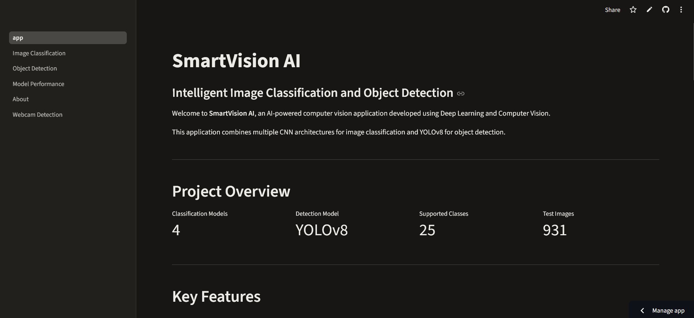
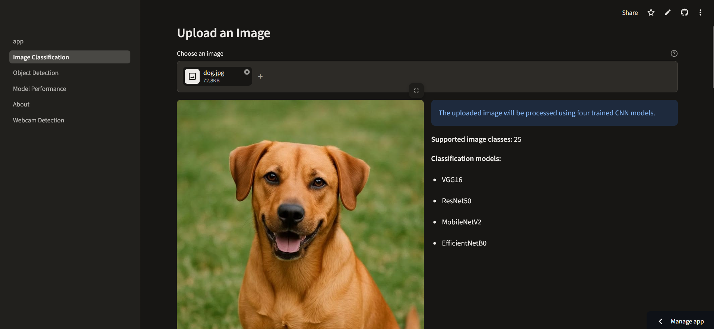
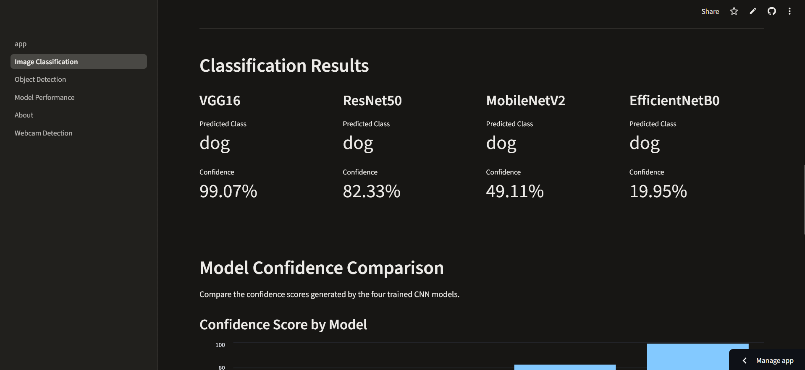
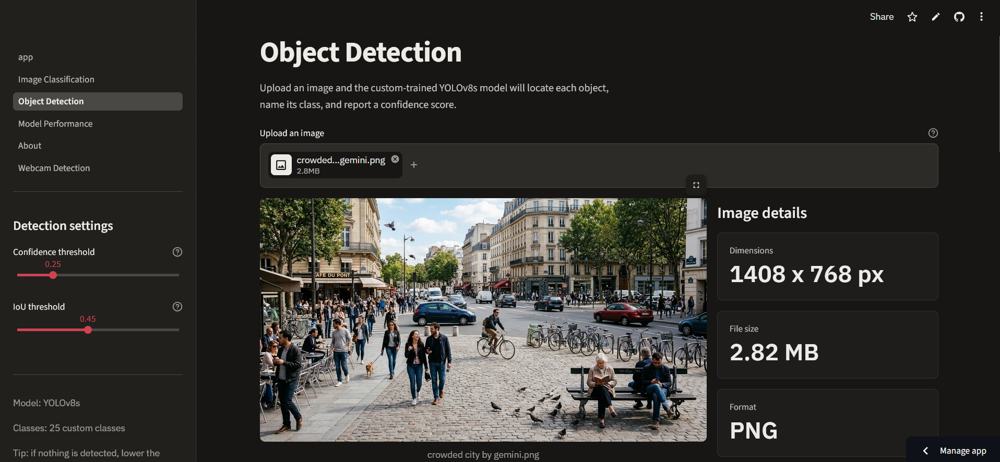
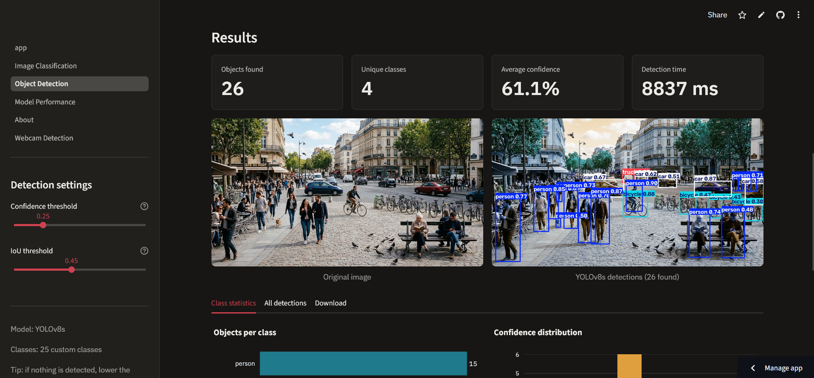
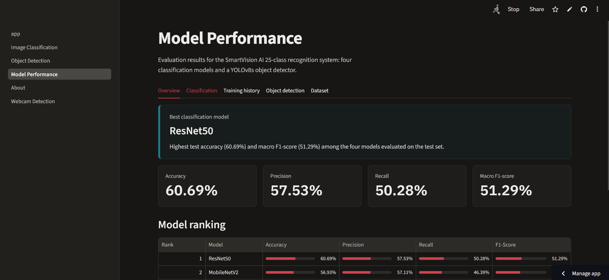
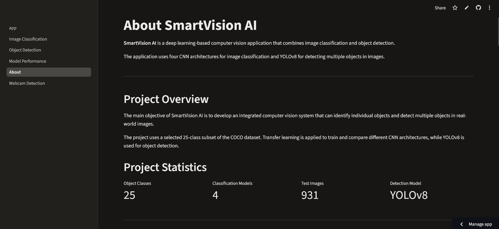
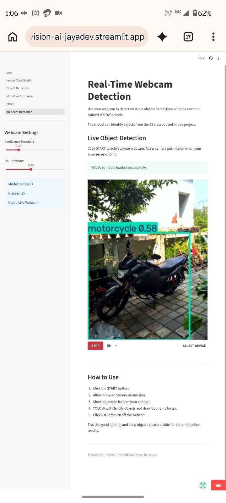

# SmartVision AI

An end-to-end computer vision application combining **image classification** and **object detection**. It uses four CNN architectures for classification and a custom-trained YOLOv8s model for detecting multiple objects across a selected 25-class COCO subset.

## Live Demo

- **Streamlit app:** https://smartvision-ai-jayadev.streamlit.app/
- **GitHub repository:** https://github.com/jay-dev-j/SmartVision-AI
- **Google Colab notebook:** [Smartvision_new(10).ipynb](notebooks/Smartvision_new%2810%29.ipynb)

## Application Screenshots

### Home


### Image Classification
The uploaded image is evaluated by four trained CNN models. The application displays each model's predicted class and confidence score.





### Object Detection
The YOLOv8s model detects multiple objects, draws bounding boxes, and reports class labels and confidence scores. Users can adjust the confidence and IoU thresholds.





### Model Performance
The performance page presents classification metrics, model comparisons, training history where available, and YOLO evaluation results.



### About


### Real-Time Webcam Detection
The webcam page uses YOLOv8s to detect objects from a live camera stream.



## Features

- Image classification using VGG16, ResNet50, MobileNetV2, and EfficientNetB0.
- Top-5 classification predictions with confidence scores.
- YOLOv8s object detection with bounding boxes, class labels, and confidence scores.
- Adjustable confidence and IoU thresholds.
- Model-performance comparison and evaluation visualizations.
- Real-time webcam object detection.
- Multi-page Streamlit interface.

## Dataset

The project uses a selected **25-class subset of the COCO dataset**.

| Dataset split | Images |
|---|---:|
| Training | 3,948 |
| Validation | 854 |
| Testing | 931 |
| **Total** | **5,733** |

For classification, individual objects were cropped from COCO images using bounding-box annotations and prepared at 224 × 224 pixels.

## Image Classification Results

Recorded test-set results from the four-model comparison:

| Model | Accuracy | Macro Precision | Macro Recall | Macro F1-score |
|---|---:|---:|---:|---:|
| VGG16 | 54.24% | 52.44% | 40.27% | 43.02% |
| ResNet50 | **60.69%** | **57.53%** | **50.28%** | **51.29%** |
| MobileNetV2 | 56.93% | 57.11% | 46.39% | 48.43% |
| EfficientNetB0 | 55.96% | 57.31% | 44.98% | 47.39% |

ResNet50 achieved the highest test accuracy and macro F1-score among the four classification models.

## Object Detection Results

The following metrics are from the YOLOv8s cleaned test-dataset evaluation.

| Metric | Result |
|---|---:|
| Precision | 47.50% |
| Recall | 37.16% |
| mAP@50 | 36.84% |
| mAP@50–95 | 22.15% |

## CPU Model Optimization

The project compared PyTorch, ONNX, and OpenVINO inference formats on CPU.

| Format | Average inference time | FPS | Model size |
|---|---:|---:|---:|
| PyTorch | 684.21 ms | 1.462 | 21.49 MB |
| ONNX | **592.48 ms** | **1.688** | 42.71 MB |
| OpenVINO | 647.78 ms | 1.544 | 42.79 MB |

ONNX had the lowest average inference time in this benchmark.

## Technology Stack

- Python
- TensorFlow / Keras
- PyTorch
- Ultralytics YOLOv8
- Streamlit
- NumPy and Pandas
- OpenCV
- Matplotlib
- Pillow

## Project Structure

```text
streamlit_app/
├── app.py
├── pages/
│   ├── 2_Image_Classification.py
│   ├── 3_Object_Detection.py
│   ├── 4_Model_Performance.py
│   ├── 5_About.py
│   └── 6_Webcam_Detection.py
├── utils/
├── models/
│   ├── classification/
│   └── detection/
├── assets/
│   ├── screenshots/
│   ├── confusion_matrices/
│   ├── training_history/
│   └── yolo_evaluation/
├── notebooks/
├── requirements.txt
├── packages.txt
└── README.md
```

## Run Locally

1. Clone the repository:

   ```bash
   git clone https://github.com/jay-dev-j/SmartVision-AI.git
   cd SmartVision-AI
   ```

2. Create and activate a virtual environment:

   ```bash
   python -m venv venv
   ```

   On Windows:

   ```powershell
   venv\Scripts\activate
   ```

3. Install dependencies:

   ```bash
   pip install -r requirements.txt
   ```

4. Start the application:

   ```bash
   streamlit run app.py
   ```

## Notes

- Image classification and object detection are separate workflows. Classification predicts a class for an input image, while YOLOv8 detects and localizes multiple objects.
- The metrics above are recorded results from the project's experiments. Actual inference performance can vary with the input and runtime environment.

## Author

Developed as an AI and Machine Learning project.
